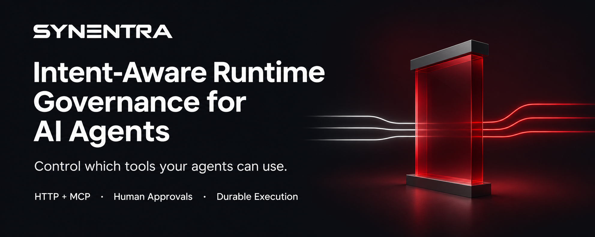
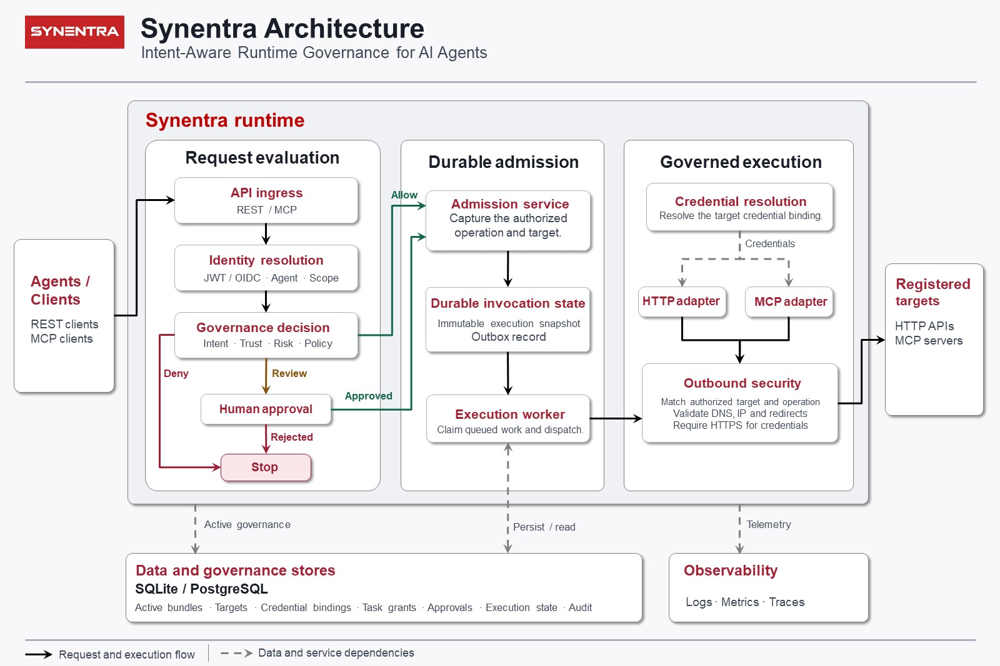

<div align="center">
  

  <h2>Intent-Aware Runtime Governance for AI Agents</h2>

  <p>
  Synentra™ governs AI-agent actions against registered HTTP APIs and MCP tools. It evaluates identity and request context against governance policies, routes sensitive actions through human approval, and executes admitted calls through a durable outbox with controlled credential access.
  </p>

[![Build Status][actions-badge]][actions-url]
[![Quality Gate Status][sonarcloud-quality-gate-badge]][sonarcloud-quality-gate-url]
[![License: Apache 2.0][apache-badge]][apache-url]
[![FOSSA License Status][fossa-license-badge]][fossa-license-url]
[![Good First Issues][github-good-first-issue-badge]][github-good-first-issue-url]

**[Documentation](https://synentra.io/docs)** ·
**[Quick Start](#quick-start)** ·
**[Discord](https://discord.synentra.io)** ·
**[Discussions](https://github.com/synentra/synentra/discussions)**

</div>

## Overview

Synentra governs AI-agent tool calls through registered operations. Each invocation carries an operation ID, arguments, and an optional binding or task grant. Synentra resolves the authenticated caller, evaluates governance rules, and returns an `allow`, `review`, or `deny` decision.

Allowed invocations enter durable execution with an immutable snapshot of the authorized operation and target. HTTP and MCP adapters use that snapshot to dispatch the call, while outbound controls enforce destination and credential requirements. Review decisions pause the invocation for human approval before admission can continue.

This README describes the current v2 implementation.

| Contract | Current value |
| --- | --- |
| REST API prefix | `/v2` |
| Invocation schema | `synentra.invocation.v2` |
| Invocation result schema | `synentra.invocation-result.v2` |
| Manifest | `apiVersion: synentra.io/v2alpha2`, `kind: GovernanceBundle` |
| MCP gateway route | `/mcp/{serverId}` |

### Implementation status

The current code includes manifest validation and activation, identity resolution, declarative and OPA policy engines, trust and risk evaluation, approvals, task grants, durable execution, HTTP and MCP adapters, credential providers, and audit APIs.

Two integration points are still incomplete in this checkout:

* The registered `default-semantic` intent provider currently returns an unavailable/error result. Governance profiles control how required intent failures affect the decision. A working intent-provider implementation is needed for semantic classification.
* OpenTelemetry configuration and integration code exist, but the call that enables observability in application startup is commented out. Structured application logging and persisted audit records are available.

## Core concepts

| Concept | Responsibility |
| --- | --- |
| **GovernanceBundle** | Versions profiles, targets, operations, bindings, restrictions, and policies as JSON or YAML. |
| **Operation** | Defines an action, its input schema, mutability, execution model, resource resolution, and governance profile. |
| **Target** | Registers the upstream endpoint and adapter, with an optional credential binding and response-retention policy. |
| **Binding** | Maps a canonical operation to an HTTP request or MCP tool and translates arguments. |
| **Invocation** | Records the authenticated agent, security scope, normalized request, and governance decision. |
| **Approval** | Records a review decision for a specific invocation. Approval is checked again when the invocation resumes. |
| **Task grant** | Provides scoped, time-bounded authority for operations that require a grant. |
| **Execution snapshot** | Captures the admitted request, target authorization, manifest revision, and credential-binding authority. |
| **Durable outbox** | Persists dispatch work for an execution worker. |

## Architecture



1. **Receive and authenticate.** REST and MCP clients submit requests through the API ingress. Identity resolution validates the caller and determines the agent identity and security scope.
2. **Evaluate governance.** Evaluate intent, trust, risk, and policy to produce an allow, review, or deny decision. Allowed requests proceed to admission. Denied requests stop.
3. **Obtain human approval when required.** Requests requiring review pause for a reviewer’s decision. Approved invocations resume admission, while rejected requests stop.
4. **Persist admitted work.** The admission service captures the authorized operation and target, then persists an immutable execution snapshot and an outbox record.
5. **Dispatch queued work.** The execution worker claims queued work and dispatches it through the HTTP or MCP adapter. Credential resolution supplies credentials through the target’s configured binding.
6. **Enforce outbound security.** Before contacting a registered HTTP API or MCP server, verify the authorized target and operation, enforce DNS/IP and redirect restrictions, and require HTTPS for credential-bearing calls.

SQLite or PostgreSQL stores active governance bundles, targets, credential bindings, task grants, approvals, execution state, and audit records. The observability layer provides the integration points for logs, metrics, and traces.

### Decisions and execution results

| Decision | Behavior |
| --- | --- |
| `allow` | Proceed through admission and queue authorized execution. |
| `review` | Create or retain an approval requirement and pause execution. |
| `deny` | Reject the invocation before dispatch. |

The invocation result separates the governance decision, approval, execution status, and outcome. A successful admission can return `202 Accepted` while dispatch is pending. Poll the invocation resource to follow progress.

If an upstream call may have occurred but its result is uncertain, execution can become `unknown`. The worker records uncertainty and avoids automatic redelivery after it has committed dispatch ownership. Use the execution reconciliation API to resolve uncertain outcomes.

## Quick start

### Build the current source

Install the .NET 10 SDK, then run these commands from the repository root:

```bash
git clone https://github.com/synentra/synentra.git
cd synentra

dotnet restore Synentra.slnx
dotnet build Synentra.slnx --configuration Release
dotnet test Synentra.slnx --configuration Release
```

### Configure a development instance

Review [the development configuration](src/Synentra/appsettings.Development.json) before starting. Configure:

* An identity provider and its issuer, audience, and claim mappings.
* SQLite or PostgreSQL persistence.
* The data-protection key-ring location and secret-provider settings.
* Outbound network restrictions suitable for your target services.

For OIDC, the default claim mapping uses `sub` for the agent ID, `security_scope` for the security scope, and `roles` for role membership. Administrative requests require an `admin` role. Review workflows use a `reviewer` or administrative principal.

The checked-in development settings use a local OIDC authority. Start and configure that identity provider, or replace its settings with those of your own provider. The development configuration also permits private outbound addresses and disables the encrypted-key-ring requirement.

Start the application with the Development environment:

```bash
# Bash
ASPNETCORE_ENVIRONMENT=Development dotnet run --project src/Synentra --configuration Release --no-launch-profile
```

```powershell
# PowerShell
$env:ASPNETCORE_ENVIRONMENT = "Development"
dotnet run --project src/Synentra --configuration Release --no-launch-profile
```

The checked-in Kestrel configuration listens on `http://localhost:7080`.

* OpenAPI UI — `http://localhost:7080/open-api`
* OpenAPI document — `http://localhost:7080/open-api/synentra/specifications.json`
* Health — `http://localhost:7080/health`

Health checks include database and active-manifest readiness. Startup also gates requests on required startup secrets.

### Register governance

Start with the [v2 GovernanceBundle example](samples/v2/filesystem-standard/filesystem-standard.yml). Adapt its endpoints, agent IDs, profiles, resolver references, and credential bindings to your deployment. Every referenced plugin and credential binding must be available before the bundle can be used.

Save your adapted file as `governance.yml`. The Bash commands below assume `SYNENTRA_ADMIN_TOKEN` contains a valid administrative access token, and the bundle retains the example name `filesystem-governance` and version `1.0.0`.

```bash
curl --fail-with-body -X POST http://localhost:7080/v2/manifests/validate \
  -H "Authorization: Bearer $SYNENTRA_ADMIN_TOKEN" \
  -H "Content-Type: application/yaml" \
  --data-binary @governance.yml

curl --fail-with-body -X PUT http://localhost:7080/v2/manifests/filesystem-governance \
  -H "Authorization: Bearer $SYNENTRA_ADMIN_TOKEN" \
  -H "Content-Type: application/yaml" \
  --data-binary @governance.yml

curl --fail-with-body -X POST http://localhost:7080/v2/manifests/filesystem-governance/activate \
  -H "Authorization: Bearer $SYNENTRA_ADMIN_TOKEN" \
  -H "Content-Type: application/json" \
  --data '{"version":"1.0.0","expectedActiveRevision":null}'
```

The storage route ID must match `metadata.name`. Inspect validation and activation results before submitting invocations. When updating an active deployment, use its current revision as `expectedActiveRevision` to detect concurrent changes.

### Invoke an operation

After activating the adapted filesystem bundle, call a registered operation using a token for an agent permitted by its policies:

```http
POST /v2/invocations
Authorization: Bearer <agent-access-token>
Content-Type: application/json
Idempotency-Key: filesystem-read-example-001

{
  "schemaVersion": "synentra.invocation.v2",
  "operationId": "filesystem.read_file",
  "bindingId": "filesystem-read-mcp",
  "arguments": {
    "path": "README.md"
  },
  "context": {
    "workflowId": "documentation-review",
    "declaredPurpose": "Read the project documentation"
  }
}
```

The authenticated principal determines agent identity and security scope. `declaredPurpose` and `workflowId` are caller-provided context used as evidence.

Use `Idempotency-Key` for mutation invocations. Reuse the same key when retrying the same request. The server checks the input digest when a key is reused.

The response includes `invocationId` and a `Location` header. Query:

```http
GET /v2/invocations/<invocation-id>
Authorization: Bearer <agent-access-token>
```

### Approve and resume

For a `review` decision, an authorized reviewer inspects the approval and submits:

```http
POST /v2/approvals/<approval-id>/approve
Authorization: Bearer <reviewer-access-token>
```

Then the caller resumes the original invocation:

```http
POST /v2/invocations/<invocation-id>/resume
Authorization: Bearer <agent-access-token>
```

Resume revalidates admission authority. The default approval configuration disables self-approval and cross-scope approval.

## HTTP and MCP integration

**HTTP adapter.** Register the target endpoint and the binding's method and path. The adapter constructs the request from the admitted snapshot, applies the configured safe headers and runtime credentials, and bounds the response size.

**MCP gateway.** Clients connect to `/mcp/{serverId}`, where `serverId` identifies a registered MCP target. The current gateway supports initialization, tool listing and calls, ping, cancellation notifications, and session deletion. It requires protocol version `2025-11-25` and binds sessions to the caller and security scope.

For MCP mutations, provide `io.synentra/idempotencyKey` in tool-call `_meta`. The gateway also accepts `io.synentra/taskGrantId` and `io.synentra/approvalId` for the associated authorization workflows.

## Configuration and credentials

Governance configuration and deployment settings have separate responsibilities:

| Location | Contents |
| --- | --- |
| Active `GovernanceBundle` in the database | Operations, bindings, target endpoints, profiles, restrictions, policies, and target response-retention rules. |
| Deployment configuration | Identity provider, persistence, outbound network limits, data protection, secret providers, logging, and worker settings. |
| Credential-binding store and secret providers | Versioned credential authority and resolved secret material. |

The secret-management model distinguishes **T0 bootstrap**, **T1 startup**, and **T2 runtime** resolution. Provider implementations include LocalVault, HashiCorp Vault, Azure Key Vault, and AWS Secrets Manager. Configure and enable the providers needed by your deployment.

Runtime credentials are resolved through the target's credential binding. Credential administration supports storing local secrets, managing bindings, rotating bindings, and changing secret state.

Outbound checks use trusted target authorization from the execution snapshot. They check the actual request URI, disable automatic redirects, validate resolved addresses before connecting, and enforce HTTPS for credential-bearing calls.

Target `responseRetention` supports explicit retention rules, including JSON property allowlists. Configure these alongside the target's endpoint and credential binding.

## API reference

Use the running instance's OpenAPI document for request and response schemas.

| Area | Routes |
| --- | --- |
| Discovery | `GET /v2/capabilities`, `GET /v2/operations` |
| Manifests | `POST /v2/manifests/validate`, `PUT /v2/manifests/{id}`, `POST /v2/manifests/{id}/activate` |
| Invocations | `POST /v2/invocations`, `GET /v2/invocations/{id}`, `POST /v2/invocations/{id}/resume` |
| Approvals | `GET /v2/approvals`, `GET /v2/approvals/{id}`, `POST /v2/approvals/{id}/approve`, `/reject`, `/revoke` |
| Executions | `GET /v2/executions/{id}`, `POST /v2/executions/{id}/reconcile`, `POST /v2/executions/{id}/cancel` |
| Task grants | `POST /v2/task-grants`, `GET /v2/task-grants/{id}`, `POST /v2/task-grants/{id}/revoke` |
| Simulation | `POST /v2/simulate` |
| Audit | `GET /v2/audits` |
| Credentials | Administrative routes under `/v2/admin/credentials` |
| MCP | `POST /mcp/{serverId}`, `DELETE /mcp/{serverId}` |

## Repository guide

| Path | Contents |
| --- | --- |
| `src/Synentra` | Application host, REST endpoints, MCP gateway, middleware, and startup. |
| `src/Synentra.Application` | Invocation normalization, governance evaluation, admission, and application contracts. |
| `src/Synentra.Domain` | Governance, approval, identity, grant, and execution models. |
| `src/Synentra.Infrastructure` | Adapters, identity and credential providers, networking, policy integrations, and background execution. |
| `src/Synentra.Persistence` | Persistence models and stores. |
| `src/Synentra.Persistence.Sqlite` | SQLite persistence provider. |
| `src/Synentra.Persistence.PostgreSql` | PostgreSQL persistence provider. |
| `samples/v2` | Examples for the current manifest and invocation model. |
| `samples/v1` | Earlier integration examples using the previous contracts. |
| `tests` | Automated test projects and load-test materials. |

## Security

Security is a core concern for Synentra. The project follows a responsible disclosure process for reported vulnerabilities.

### Reporting a Vulnerability

**Do not report security vulnerabilities through a public GitHub issue.**

Use one of the following private channels:

* **GitHub Private Vulnerability Reporting:**
  [Report a vulnerability](https://github.com/synentra/synentra/security/advisories/new)

* **Email:**
  [security@synentra.io](mailto:security@synentra.io)
  Subject: `[Synentra] Security Vulnerability`

Include, where possible:

* A description of the vulnerability
* Its potential impact
* Steps to reproduce
* A proof of concept
* Relevant environment information
* The affected Synentra version

We aim to acknowledge security reports within 48 hours and provide an initial remediation timeline within several days.

### Security Policy

Supported versions and the complete disclosure process are documented in:

**[SECURITY.md](SECURITY.md)**

### Dependency and Code Analysis

Synentra uses:

* [FOSSA](https://fossa.com) for dependency license and vulnerability analysis
* [SonarCloud](https://sonarcloud.io) for static analysis, reliability, maintainability, and security checks

Additional project-health badges are available in the [Project Health](#project-health) section.

## Community and Contributing

Synentra is developed in the open. Contributions may include code, tests, documentation, integrations, issue reports, feature proposals, and design discussions.

### Ways to Participate

* 🐛 [Report a bug](https://github.com/synentra/synentra/issues/new?template=bug_report.md)
* 💡 [Request a feature](https://github.com/synentra/synentra/issues/new?template=feature_request.md)
* 🔍 [Browse good first issues](https://github.com/synentra/synentra/issues?q=is%3Aissue+is%3Aopen+label%3A%22good+first+issue%22)
* 📖 Improve the documentation
* 🧪 Add tests and examples
* 🔌 Propose or implement integrations
* 💬 Join project discussions

### Contributing Code

1. Fork the repository.
2. Create a branch from `main`.
3. Implement the change.
4. Add or update tests.
5. Run the test suite:

```bash
dotnet test --configuration Release
```

6. Open a pull request against `main` with a clear explanation of the change.

Read [CONTRIBUTING.md](CONTRIBUTING.md) before submitting a pull request.

### Community Channels

* **Discord:** https://discord.synentra.io
* **GitHub Discussions:** https://github.com/synentra/synentra/discussions
* **Documentation:** https://synentra.io/docs

### Discussion Categories

| Category      | Purpose                                 |
| ------------- | --------------------------------------- |
| Q&A           | Ask questions and receive help          |
| Ideas         | Propose features and improvements       |
| Contributors  | Coordinate contribution work            |
| Governance    | Discuss project direction and decisions |
| Show and Tell | Share integrations and projects         |
| Announcements | Follow releases and project updates     |

## Project Health

[![.NET][dotnet-budge]][dotnet-url]
[![Build Status][actions-badge]][actions-url]
[![Quality Gate Status][sonarcloud-quality-gate-badge]][sonarcloud-quality-gate-url]
[![Reliability Gate Status][sonarcloud-reliability-gate-badge]][sonarcloud-reliability-gate-url]
[![Maintainability Gate Status][sonarcloud-maintainability-gate-badge]][sonarcloud-maintainability-gate-url]
[![Security Gate Status][sonarcloud-security-gate-badge]][sonarcloud-security-gate-url]
[![Vulnerabilities Gate Status][sonarcloud-vulnerabilities-gate-badge]][sonarcloud-vulnerabilities-gate-url]
[![FOSSA License Status][fossa-license-badge]][fossa-license-url]
[![FOSSA Security Status][fossa-security-badge]][fossa-security-url]

## Governance

Project governance and maintainer responsibilities are documented in:

* [GOVERNANCE.md](GOVERNANCE.md)
* [MAINTAINERS.md](MAINTAINERS.md)
* [CODE_OF_CONDUCT.md](CODE_OF_CONDUCT.md)
* [ROADMAP.md](ROADMAP.md)

## License

Synentra is open source and licensed under the
[Apache License 2.0](LICENSE).

Some dependencies use other open-source licenses. Their notices and attribution requirements are documented in:

[**THIRD-PARTY-NOTICES.md**](THIRD-PARTY-NOTICES.md)

## Trademark

Synentra™ and the Synentra logo are trademarks claimed by Amin Ziagham.

The Synentra source code is licensed under the Apache License 2.0. The license does not grant permission to use the Synentra name or logo in a way that implies endorsement, affiliation, sponsorship, or that a modified distribution is an official Synentra product.

See [**TRADEMARKS.md**](TRADEMARKS.md) for trademark usage guidelines.

## Support Synentra

If Synentra solves a problem for your team, consider starring the repository. It helps other developers discover the project and follow its development.

[](https://github.com/synentra/synentra)

## Contributors

Thanks to all the contributors who help make Synentra better! ❤️

<a href="https://github.com/synentra/synentra/graphs/contributors">
  
</a>


[dotnet-budge]: https://img.shields.io/badge/.NET-10.0-purple
[dotnet-url]: https://dotnet.microsoft.com/en-us/download/dotnet/10.0
[apache-badge]: https://img.shields.io/badge/License-Apache%202.0-blue.svg?style=flat&logo=github
[apache-url]: https://opensource.org/licenses/Apache-2.0
[actions-badge]: https://github.com/synentra/synentra/actions/workflows/build.yml/badge.svg?branch=main
[actions-url]: https://github.com/synentra/synentra/actions?workflow=build
[github-good-first-issue-badge]: https://img.shields.io/github/issues/synentra/synentra/good%20first%20issue?style=flat-square&logo=github&label=good%20first+issues
[github-good-first-issue-url]: https://github.com/synentra/synentra/issues?q=is%3Aissue+is%3Aopen+label%3A%22good+first+issue%22
[sonarcloud-quality-gate-badge]: https://sonarcloud.io/api/project_badges/measure?project=synentra_synentra&metric=alert_status&token=0b5b5ca3c5f12401df0abb73c369c8a620fc174a
[sonarcloud-quality-gate-url]: https://sonarcloud.io/summary/new_code?id=synentra_synentra
[sonarcloud-reliability-gate-badge]: https://sonarcloud.io/api/project_badges/measure?project=synentra_synentra&metric=reliability_rating&token=0b5b5ca3c5f12401df0abb73c369c8a620fc174a
[sonarcloud-reliability-gate-url]: https://sonarcloud.io/summary/new_code?id=synentra_synentra
[sonarcloud-maintainability-gate-badge]: https://sonarcloud.io/api/project_badges/measure?project=synentra_synentra&metric=sqale_rating&token=0b5b5ca3c5f12401df0abb73c369c8a620fc174a
[sonarcloud-maintainability-gate-url]: https://sonarcloud.io/summary/new_code?id=synentra_synentra
[sonarcloud-security-gate-badge]: https://sonarcloud.io/api/project_badges/measure?project=synentra_synentra&metric=security_rating&token=0b5b5ca3c5f12401df0abb73c369c8a620fc174a
[sonarcloud-security-gate-url]: https://sonarcloud.io/summary/new_code?id=synentra_synentra
[sonarcloud-vulnerabilities-gate-badge]: https://sonarcloud.io/api/project_badges/measure?project=synentra_synentra&metric=vulnerabilities&token=0b5b5ca3c5f12401df0abb73c369c8a620fc174a
[sonarcloud-vulnerabilities-gate-url]: https://sonarcloud.io/summary/new_code?id=synentra_synentra
[fossa-license-badge]: https://app.fossa.com/api/projects/git%2Bgithub.com%2Fsynentra%2Fsynentra.svg?type=shield&issueType=license
[fossa-license-url]: https://app.fossa.com/projects/git%2Bgithub.com%2Fsynentra%2Fsynentra?ref=badge_shield&issueType=license
[fossa-security-badge]: https://app.fossa.com/api/projects/git%2Bgithub.com%2Fsynentra%2Fsynentra.svg?type=shield&issueType=security
[fossa-security-url]: https://app.fossa.com/projects/git%2Bgithub.com%2Fsynentra%2Fsynentra?ref=badge_shield&issueType=security
